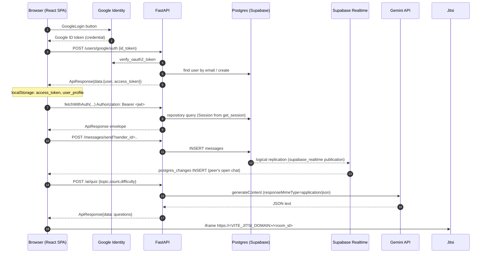
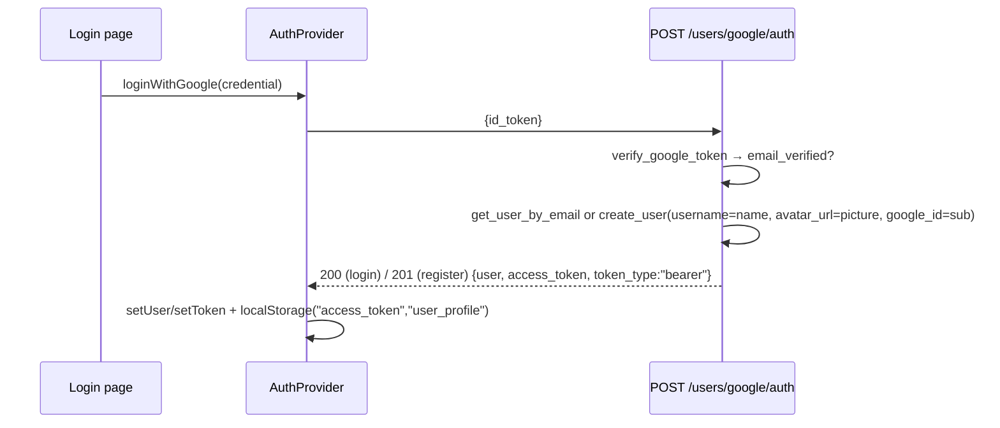
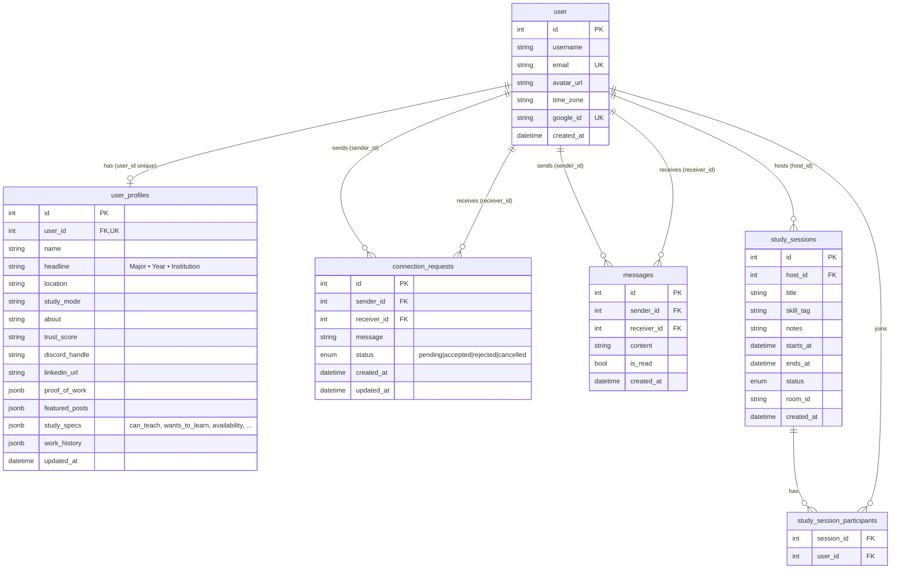

# StudyBuddy — System Architecture

StudyBuddy is a study-partner platform: students sign in with Google, build a profile (skills they
teach / want to learn, proof of work), find and connect with study buddies, message them, schedule
video study sessions, and use a Gemini-powered AI suite (tutor, quiz, notes → flashcards, study plan).

This document is the entry point. Feature-level details live in the docs listed in
[Docs index](#docs-index).

---

## 1. Repository layout

```
study-buddy/
├── backend/                     FastAPI API (Python >= 3.14, Poetry)
│   ├── app/
│   │   ├── main.py              App factory: CORS, routers, exception handlers, lifespan(init_db)
│   │   ├── env.py               Loads backend/.env into ENV (SimpleNamespace)
│   │   ├── db/database.py       SQLModel engine, init_db(), get_session()
│   │   ├── models/              SQLModel tables + request/response schemas per domain
│   │   ├── schemas/             Pure Pydantic schemas (Google auth, full profile, buddy cards)
│   │   ├── repository/          Data-access classes (one per domain), take a Session
│   │   ├── routes/              APIRouters: users, profile, connections, search, messages, ai, sessions
│   │   ├── services/
│   │   │   ├── auth/            Google ID-token verification, JWT issue/decode
│   │   │   └── ai/              Gemini REST client (generate_json)
│   │   ├── utils/api/           ApiResponse / ApiError envelope
│   │   ├── utils/logger.py      stdlib logging, logger name "study-buddy"
│   │   └── scripts/seed_users.py  Idempotent dev seeder
│   ├── migrations/              Alembic env + versions/
│   ├── alembic.ini, pyproject.toml, startup.sh
│   └── ARCHITECTURE.md          Backend how-to (add route/model/migration)
├── frontend/                    React 19 + Vite 8 + Tailwind v4 SPA
│   ├── src/
│   │   ├── main.tsx, App.tsx    GoogleOAuthProvider → RouterProvider
│   │   ├── routes/              router.tsx (live), Layout.tsx, protectedroute.tsx
│   │   ├── context/AuthProvider.tsx
│   │   ├── pages/               Home, Login, Profile, Search, Buddies, Chat, Sessions, SessionRoom, AiSuite, Error
│   │   ├── hooks/               One hook module per domain (see §6)
│   │   ├── components/          ai/, buddies/, login/, navbar/, profile/, search/
│   │   ├── types/               buddy.ts, profile.ts, children.ts
│   │   └── utils/               env.ts (Zod), fetchAuth.ts, supabaseClient.ts, time.ts, logger.ts
│   ├── docs/                    theme.md, home-dashboard.md
│   └── netlify.toml, wrangler.jsonc, public/__redirects   SPA hosting configs
├── docs/                        Project documentation (this folder)
├── GEMINI.md                    Agent/contributor guidelines
└── README.md
```

## 2. Tech stack

| Layer | Choice |
|---|---|
| API | FastAPI (`fastapi[standard]`), Uvicorn, Pydantic v2 |
| ORM / DB | SQLModel (SQLAlchemy) on PostgreSQL (hosted on Supabase), JSONB for nested profile data |
| Migrations | Alembic (`backend/migrations`) + `SQLModel.metadata.create_all` on startup |
| Auth | Google Identity (`google-auth` verifies ID tokens), PyJWT HS256 access tokens |
| AI | Google Gemini REST API (`generateContent`, JSON response mode) via `requests` |
| Tooling | Poetry, poethepoet (`poe dev`), pylint |
| Frontend | React 19, TypeScript 6, Vite 8, Tailwind CSS v4, react-router-dom 7 |
| Frontend libs | `@react-oauth/google`, `@supabase/supabase-js` (Realtime), Zod (env), react-icons, pino |
| Video | Jitsi Meet iframe embed (default `meet.jit.si`) |
| Hosting configs | Netlify (`netlify.toml`) and Cloudflare Workers (`wrangler.jsonc`) for the SPA |

## 3. Request flow



## 4. Backend layering

```
routes/*.py  →  repository/*.py  →  models/*.py (SQLModel tables)  →  Postgres
     │                                   ▲
     └── schemas/*.py, models/*Schema ───┘   (Pydantic request/response shapes)
```

- **Routes** (`app/routes/`) declare an `APIRouter(prefix=..., tags=[...])`, receive a DB session via
  `session: Session = Depends(get_session)`, validate input, call a repository, and return
  `ApiResponse.success(...)`. Business rules live here (e.g. "only accepted buddies can message").
- **Repositories** (`app/repository/`) are plain classes constructed with a `Session`
  (`UserRepository`, `ProfileRepository`, `ConnectionRepository`, `MessageRepository`,
  `study_session_repo`). They own all `select(...)`/`commit()` calls.
- **Models** (`app/models/`) hold `table=True` SQLModel classes plus the domain's request/response
  schemas (e.g. `SendMessageSchema`, `MessageResponseSchema`). `app/models/__init__.py` imports all
  tables so `SQLModel.metadata` is complete.
- **Services** (`app/services/`) wrap external systems: Google token verification + JWT creation
  (`services/auth/`), Gemini (`services/ai/gemini_service.py`).

### Response envelope

Every endpoint returns the same JSON shape (`app/utils/api/api_response.py`):

```json
{ "status": "success|error", "status_code": 200, "message": "…", "metadata": null, "data": … }
```

- `ApiResponse.success(message, status_code, data, metadata)` / `ApiResponse.error(...)` build a
  `JSONResponse` from `TypeApiResponse`.
- `ApiError(message, status_code=400, metadata=None)` (`api_error.py`) is an `HTTPException` whose
  `detail` is the error envelope. Raise it from routes/services.

### Exception handlers (`app/main.py`)

| Handler | Catches | Result |
|---|---|---|
| `global_http_exception_handler` | `StarletteHTTPException` (incl. `ApiError`, 404s, 401s) | Envelope using `detail.message` / `detail.metadata` when `detail` is a dict, else `str(detail)` |
| `validation_exception_handler` | `RequestValidationError` | 422, message `"Validation failed for incoming request data."`, `metadata` = Pydantic errors |
| `unhandled_exception_handler` | `Exception` | 500 `"Internal Server Error"`, logged with traceback |

The frontend relies on this: hooks read `json.message` on non-2xx and `json.data` on success.

### Logging

`app/utils/logger.py` configures stdlib `logging` at `INFO` with a timestamped format; import
`logger` from there. (`LOG_LEVEL` is read into `ENV` but not applied.) The SQLAlchemy engine is
created with `echo=True`, so SQL is logged too.

### Database session & schema management

- `app/db/database.py` creates one engine from `POSTGRES_URL`. `get_session()` is a generator
  dependency yielding a `Session` per request.
- `init_db()` runs in the FastAPI `lifespan`: `SQLModel.metadata.create_all(engine)` (creates any
  missing tables, never alters existing ones) and a `SELECT 1` connectivity check. Errors are logged,
  not raised.
- **Alembic** (`backend/migrations`, `alembic.ini`) handles changes `create_all` can't (indexes,
  dropping legacy tables, Supabase RLS/Realtime setup). `migrations/env.py` reads `POSTGRES_URL`
  from `ENV`, rewrites `postgres://` → `postgresql://`, and targets `SQLModel.metadata`.
  Revision chain: `579ef4faa08d` (user.google_id index) → `b6d74aff7b8b` (drop legacy
  `app_user`/`userprofile`) → `70cd8f5e4e31` (messages + RLS/Realtime) → `c3a91d7e5f20` (study_sessions).
  See [backend/ARCHITECTURE.md](../backend/ARCHITECTURE.md) for how the two mechanisms interact.

### Routers (registered in `main.py`)

| Prefix | File | Docs |
|---|---|---|
| `/` | `main.py` | Health/welcome |
| `/users` | `user_route.py` | [auth-and-profile.md](auth-and-profile.md) |
| `/profile` | `profile_route.py` | [auth-and-profile.md](auth-and-profile.md) |
| `/connections` | `connection_route.py` | [connections-and-search.md](connections-and-search.md) |
| `/search` | `search_route.py` | [connections-and-search.md](connections-and-search.md) |
| `/messages` | `message_route.py` | [messaging.md](messaging.md) |
| `/ai` | `ai_route.py` | [ai-suite.md](ai-suite.md) |
| `/sessions` | `study_session_route.py` | [study-sessions.md](study-sessions.md) |

CORS allows only `http://localhost:5173` and `http://localhost:5174` (hardcoded in `main.py`).

## 5. Authentication



1. `pages/Login.tsx` renders `<GoogleLogin>` (inside `GoogleOAuthProvider clientId=VITE_GOOGLE_CLIENT_ID`).
2. `AuthProvider.loginWithGoogle` posts the credential to `/users/google/auth`.
   Note: this URL is **hardcoded** to `http://localhost:8000`, not `VITE_API_BASE_URL`.
3. Backend (`services/auth/google_service.py`) verifies the token with `google.oauth2.id_token`,
   checks issuer and `email_verified`, then finds-or-creates the user by email and issues a JWT
   (`sub` = user id, `email`, `exp` = now + 30 days, HS256, signed with `JWT_SECRET_KEY`).
4. The SPA stores `access_token` and `user_profile` in `localStorage`; `AuthProvider` rehydrates from
   them on reload. `ProtectedRoute` only checks that `user` is present (no expiry check).
5. All data hooks call `utils/fetchAuth.ts → fetchWithAuth(url, options)`, which adds
   `Content-Type: application/json` and `Authorization: Bearer <token>`. On **401** it clears both
   keys and hard-redirects to `/login`.
6. Logout (`Layout.tsx`) calls `googleLogout()` and clears state + storage.

> **Security caveat — the JWT is not enforced.** Only `GET /users/me` depends on
> `get_current_user` (`services/auth/dependency.py`). Every other route identifies the caller from a
> client-supplied `user_id` / `sender_id` query or path parameter, so any client can read or write
> data as any user (e.g. read any message thread, edit any profile). Also:
> `GOOGLE_CLIENT_ID` is read with `os.getenv` and is absent from `backend/.env.example`; when unset,
> the Google token's audience is not checked. `JWT_SECRET_KEY` has a hardcoded fallback in
> `app/env.py`. Fixing this means adding `Depends(get_current_user)` to routes and deriving the
> user id from the token.

Details: [auth-and-profile.md](auth-and-profile.md).

## 6. Data model



- `connection_requests` has a unique constraint on `(sender_id, receiver_id)`. Two users are
  "buddies" when a request between them (either direction) has status `accepted`.
- `messages` has composite indexes `(sender_id, receiver_id)` and `(receiver_id, sender_id)`.
- Study sessions are being reworked to a host + participants model (shown above); see
  [study-sessions.md](study-sessions.md) for the authoritative schema.

## 7. Frontend structure

### Routes (`frontend/src/routes/router.tsx`)

Everything is wrapped in `<AuthProvider>`. All routes except `/login` and `*` sit under
`<ProtectedRoute><Layout/></ProtectedRoute>` (navbar + `<Outlet/>`).

| Path | Page | Notes |
|---|---|---|
| `/login` | `Login.tsx` | Public; Google sign-in |
| `/` | `Home.tsx` | Dashboard — [home-dashboard.md](../frontend/docs/home-dashboard.md) |
| `/search` | `Search.tsx` | [connections-and-search.md](connections-and-search.md) |
| `/my-buddies` | `Buddies.tsx` | [connections-and-search.md](connections-and-search.md) |
| `/profile`, `/profile/:id` | `Profile.tsx` | Own profile (editable) or a peer's |
| `/chat` | `Chat.tsx` | `?peer=<id>` deep link — [messaging.md](messaging.md) |
| `/session` | `Sessions.tsx` | [study-sessions.md](study-sessions.md) |
| `/session/:id/room` | `SessionRoom.tsx` | Jitsi video room (§9) |
| `/ai` | `AiSuite.tsx` | `?tab=tutor\|quiz\|summarizer\|roadmap` — [ai-suite.md](ai-suite.md) |
| `*` | `Error.tsx` | 404 |

`routes/index.tsx` is an older, unused router; `App.tsx` uses `router.tsx`.

### Hooks (one per domain)

| Hook | Backend | Used by |
|---|---|---|
| `useAuth` (context from `AuthProvider`) | `/users/google/auth` | everywhere |
| `useProfile(userId)` | `/profile/full/{id}`, `/profile/{id}`, `/profile/onboard` | Profile, Home |
| `useMessages(userId)` | `/messages/*` + Supabase Realtime | Chat, Home |
| `useAiSuite()` | `/ai/*` | AiSuite |
| `useSearch`, `useConnectionActions`, `useBuddies` | `/search`, `/connections` | Search, Buddies, Home |
| `useSessions`, `fetchSession`, `liveStatus`, `useNow` | `/sessions` | Sessions, SessionRoom, Home |

### Utils

- `env.ts` — Zod-validates `import.meta.env` at startup; a missing required var throws on load.
- `fetchAuth.ts` — `fetchWithAuth` (see §5).
- `supabaseClient.ts` — exports `supabase` (or `null`) and `isSupabaseConfigured`.
- `time.ts` — `formatDayLabel`, `formatClock`, `formatTimeRange`, `formatRelative`, date-input helpers, `greetingForNow`.
- `logger.ts` — pino logger.

Styling follows [frontend/docs/theme.md](../frontend/docs/theme.md) (dark, zinc + emerald, glass cards).

## 8. Realtime chat

`useMessages` always works by polling and upgrades to push when Supabase is configured:

| Mode | Condition | Thread updates | Conversation list |
|---|---|---|---|
| Polling | `VITE_SUPABASE_URL`/`VITE_SUPABASE_ANON_KEY` unset | `GET /messages/thread/{me}/{peer}?after_id=<max id>` every 3 s | every 8 s |
| Realtime | both set | Supabase `postgres_changes` INSERT on `public.messages`, plus a 15 s safety poll | every 8 s + on each event |

The `70cd8f5e4e31` migration best-effort enables RLS with permissive `SELECT`/`INSERT` policies,
grants to `anon`/`authenticated`, and adds `messages` to the `supabase_realtime` publication.
Writes still go through FastAPI. See [messaging.md](messaging.md) — including the privacy caveat
that those policies expose all messages to anyone holding the anon key.

## 9. AI suite

- `backend/app/services/ai/gemini_service.py → generate_json(prompt)` POSTs to
  `https://generativelanguage.googleapis.com/v1beta/models/{GEMINI_MODEL}:generateContent` with
  `responseMimeType: application/json`, parses the first candidate's text as JSON, and retries up to
  3 attempts on 429/503 (honouring Google's `retryDelay`). 30 s timeout per call.
- `backend/app/routes/ai_route.py` exposes `POST /ai/roadmap`, `/ai/quiz`, `/ai/summarize`,
  `/ai/tutor`; any failure becomes `502 "AI generation failed. Please try again."`.
- Frontend: `useAiSuite` + `pages/AiSuite.tsx` + `components/ai/Markdown.tsx`.

Details: [ai-suite.md](ai-suite.md).

## 10. Video rooms

`/session/:id/room` (`pages/SessionRoom.tsx`) loads the session via `fetchSession`, and once the
user clicks **Join video room** renders an `<iframe>` to
`https://${VITE_JITSI_DOMAIN || "meet.jit.si"}/${session.room_id}#config.prejoinPageEnabled=false&...&userInfo.displayName="<username>"`
with camera/mic/display-capture permissions. Joining is only offered while the session is
`upcoming` or `live`. A **New tab** link opens the same URL outside the iframe; **Chat** links to
`/chat?peer=<partner_id>`.

> **Caveat:** the public `meet.jit.si` service limits *embedded* meetings to about 5 minutes (and
> requires a signed-in moderator). For real sessions set `VITE_JITSI_DOMAIN` to a self-hosted Jitsi
> or JaaS (8x8.vc) domain, or use the **New tab** button.

Scheduling details: [study-sessions.md](study-sessions.md).

## 11. Environment variables

Names only — never commit values. Backend values live in `backend/.env` (loaded by `app/env.py`);
frontend values in `frontend/.env` (Vite exposes only `VITE_*`, and **everything `VITE_*` ships to
the browser**).

### Backend

| Name | Required | Used for |
|---|---|---|
| `POSTGRES_URL` | yes | SQLModel engine and Alembic (`postgres://` is normalized for Alembic) |
| `JWT_SECRET_KEY` | yes (has an insecure fallback) | Signing/verifying access tokens |
| `GOOGLE_CLIENT_ID` | should be | Audience check for Google ID tokens (`google_service.py`, via `os.getenv`) |
| `GEMINI_API_KEY` | for AI | Gemini API key (server-side only) |
| `GEMINI_MODEL` | no (default `gemini-3.1-flash-lite`) | Gemini model name |
| `SUPABASE_URL`, `SUPABASE_KEY` | no | Loaded into `ENV`; not currently used by the API |
| `HOST`, `PORT`, `LOG_LEVEL` | no | Loaded into `ENV`; not currently applied (port comes from `poe dev`) |

`backend/.env.example` is stale: it lists `BASE_URL`, `APP_ENV`, `POSTGTRES_PASSWORD` and
`POSTGRESS_URL` (typo — the code reads `POSTGRES_URL`) and omits most of the above.

### Frontend (`frontend/src/utils/env.ts`)

| Name | Required | Used for |
|---|---|---|
| `VITE_API_BASE_URL` | yes (URL) | Base URL for all API hooks |
| `VITE_BASE_URL` | yes (URL) | Validated; not otherwise used |
| `VITE_NODE_ENV` | yes | Validated; not otherwise used |
| `VITE_GOOGLE_CLIENT_ID` | yes | `GoogleOAuthProvider` |
| `VITE_GOOGLE_CLIENT_SECRET` | yes (schema) | Not used — and a client secret must not be shipped to the browser; should be removed |
| `VITE_SUPABASE_URL`, `VITE_SUPABASE_ANON_KEY` | optional | Enable Realtime chat (anon key only, never service_role) |
| `VITE_JITSI_DOMAIN` | optional | Jitsi host for video rooms (missing from `.env.example`) |

## 12. Known gaps (summary)

- JWT not enforced on most routes; identity comes from request params (§5).
- Permissive Supabase RLS on `messages` + client-side-only filtering of Realtime events (§8).
- `user_route.py` re-assigns `router` halfway through, so `POST /users/create`, `GET /users/all`
  and `GET /users/{user_id}` are defined but **not registered**.
- Hardcoded `localhost` in `AuthProvider` and CORS — production deploys need both made configurable.
- `meet.jit.si` embed time limit (§10). No tests in the repo.

## Docs index

| Doc | Topic |
|---|---|
| [docs/ARCHITECTURE.md](ARCHITECTURE.md) | This file — system overview |
| [docs/ROADMAP.md](ROADMAP.md) | MVP checklist and status |
| [docs/auth-and-profile.md](auth-and-profile.md) | Google login, JWT, profile endpoints and edit flow |
| [docs/profile-edit.md](profile-edit.md) | Original profile-edit change log + seeding |
| [docs/messaging.md](messaging.md) | Direct messaging, unread counts, live updates |
| [docs/connections-and-search.md](connections-and-search.md) | Buddy requests and search |
| [docs/buddy-matching-search.md](buddy-matching-search.md) | Earlier search/buddies wiring notes |
| [docs/study-sessions.md](study-sessions.md) | Study session scheduling and rooms |
| [docs/ai-suite.md](ai-suite.md) | Gemini AI suite |
| [frontend/docs/home-dashboard.md](../frontend/docs/home-dashboard.md) | Home dashboard |
| [frontend/docs/theme.md](../frontend/docs/theme.md) | Design system |
| [backend/ARCHITECTURE.md](../backend/ARCHITECTURE.md) | Backend how-to (routes, models, migrations) |
| [GEMINI.md](../GEMINI.md) | Contributor / agent guidelines |
