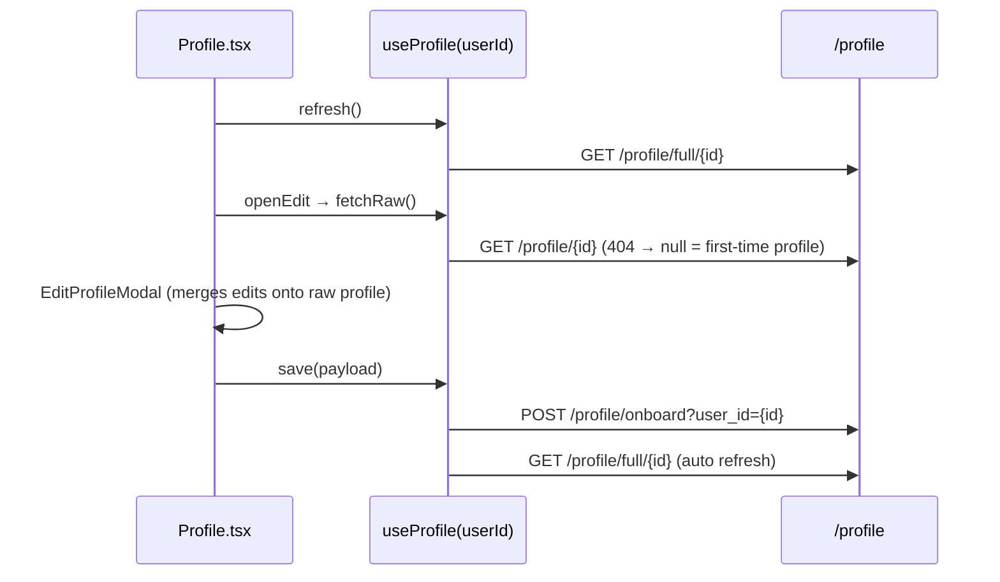

# Auth & Profile

Google sign-in, app JWTs, and the user profile (view, peer view, edit).
System context: [ARCHITECTURE.md](ARCHITECTURE.md). Historical change notes for the edit modal and
seed data: [profile-edit.md](profile-edit.md).

## Files

| Area | File |
|---|---|
| User routes | `backend/app/routes/user_route.py` (prefix `/users`) |
| Profile routes | `backend/app/routes/profile_route.py` (prefix `/profile`) |
| Google + JWT | `backend/app/services/auth/google_service.py`, `token.py`, `dependency.py` |
| Models | `backend/app/models/user_model.py` (`User`, `UserProfile`, `ProfileCreate`, `ProfileRead`, `AuthResponse`) |
| Full-profile schema | `backend/app/schemas/profile_page_schema.py` (`FullUserProfileResponse`) |
| Repositories | `backend/app/repository/user_repository.py`, `profile_repo.py` |
| Frontend auth | `frontend/src/context/AuthProvider.tsx`, `hooks/useAuth.ts`, `routes/protectedroute.tsx`, `utils/fetchAuth.ts`, `pages/Login.tsx` |
| Frontend profile | `frontend/src/hooks/useProfile.ts`, `pages/Profile.tsx`, `components/profile/EditProfileModal.tsx`, `types/profile.ts` |
| Seeder | `backend/app/scripts/seed_users.py` |

## Login flow

1. `Login.tsx` shows `<GoogleLogin>`; on success it has a Google **ID token** (`credential`).
2. `AuthProvider.loginWithGoogle(idToken)` → `POST http://localhost:8000/users/google/auth`
   with `{ "id_token": "..." }` (URL is hardcoded, not `VITE_API_BASE_URL`).
3. Backend `verify_google_token`: `id_token.verify_oauth2_token(token, Request(), GOOGLE_CLIENT_ID)`,
   issuer must be `accounts.google.com`, `email_verified` must be true (else 400); invalid/expired → 401.
4. Find user by email; if missing, create one with `username = name`, `avatar_url = picture`,
   `google_id = sub`. Status **201** for new users, **200** for returning ones.
5. Issue JWT: `{sub: "<user id>", email, exp: now + 30 days}`, HS256, `JWT_SECRET_KEY`.
6. Response `data` = `AuthResponse {user: UserRead, access_token, token_type: "bearer"}`.
7. Frontend stores `localStorage.access_token` and `localStorage.user_profile` (the `UserRead`
   object: `id, email, username, avatar_url, time_zone, google_id, created_at`) and navigates to `/`.

Session handling on the client:

- `AuthProvider` rehydrates `token`/`user` from localStorage on load; `useAuth()` exposes
  `{user, token, loginWithGoogle, logout, isAuthenticated}`.
- `ProtectedRoute` redirects to `/login` when `user` is null (it doesn't inspect token expiry).
- `fetchWithAuth` adds `Authorization: Bearer <token>`; any **401** clears storage and redirects to `/login`.
- `Layout` logout = `googleLogout()` + `logout()` (clears state and storage).
- There are no refresh tokens; after 30 days the token expires (only noticed on `/users/me`).

## User endpoints

| Method | Path | Params | Purpose |
|---|---|---|---|
| POST | `/users/google/auth` | body `{id_token}` | Verify Google ID token, find-or-create user, return `{user, access_token, token_type}` |
| GET | `/users/me` | header `Authorization: Bearer <jwt>` | Current user (`UserRead`). The **only** route that enforces the JWT (`get_current_user`) |

`user_route.py` also defines `POST /users/create`, `GET /users/all` and `GET /users/{user_id}`,
but the module re-assigns `router = APIRouter(...)` before `/google/auth`, so those three are
**not registered** and return 404.

## Profile endpoints

| Method | Path | Params | Purpose |
|---|---|---|---|
| POST | `/profile/onboard` | query `user_id`; body `ProfileCreate` | Create or update (upsert) the user's profile. On update only fields present in the body are changed (`exclude_unset`). Returns `ProfileRead` (201). |
| GET | `/profile/{user_id}` | — | Raw profile row (`ProfileRead`), 404 if the user has no profile yet. Used to prefill the edit form. |
| GET | `/profile/full/{user_id}` | — | Display-ready `FullUserProfileResponse` built from `User` + `UserProfile` (works even with no profile row). 404 if the user doesn't exist. |
| GET | `/profile/peers/all` | query `skip=0`, `limit=20` | Paged list of raw profiles. |

None of these check the JWT: `/profile/onboard?user_id=X` lets any caller overwrite user X's profile.

### `ProfileCreate` body (raw shape)

`name` (required), `headline` (`"Major • Year • Institution"`), `location`, `study_mode`
(default `"Hybrid Mode"`), `about`, `trust_score` (default `"Verified Learner"`), `discord_handle`,
`linkedin_url`, and JSONB fields `proof_of_work` (`{github, medium, dribbble, devTo, kaggle, personalWebsite}`),
`featured_posts` (list), `study_specs` (`{can_teach, wants_to_learn, availability, learning_approach, timezone}`),
`work_history` (list of `{role, company, duration, description}`).

`ProfileRead` adds `id`, `user_id`, `updated_at`, and optional `username`/`avatar_url` (currently
always `null` because they're not on the profile row).

### `FullUserProfileResponse` (display shape)

Built by `build_full_profile(user, profile)` in `profile_route.py`:

| Field | Source |
|---|---|
| `id` | `"usr_<user.id>"` (string) |
| `name`, `bio`, `location` | profile `name` / `about` / `location`, else username / placeholder text |
| `username` | `user.username` lowercased, spaces → `_` |
| `avatarUrl` | `user.avatar_url` (Google picture) |
| `academicDetails` | `headline` split on `•` into major / year / institution |
| `studyPreferences` | `study_mode` normalized to `online`/`in-person`/`hybrid`; `study_specs.timezone`/`availability`/`learning_approach` |
| `skills` | `study_specs.wants_to_learn` → `learning`, `study_specs.can_teach` → `teaching` |
| `workExperience`, `featuredPosts`, `proofOfWork` | from the JSONB columns |
| `socials` | GitHub URL from `proof_of_work.github.url`, `linkedin_url`, `discord_handle` |
| `status` | always `{isSearching: true, lastActive: "Just now"}` |

> Missing values are filled with **hardcoded placeholders** (e.g. major "Computer Science",
> institution "Stanford University", skills "Python"/"JavaScript", discord "study_buddy#0001"),
> so a brand-new user's profile looks populated. Treat those as defaults, not data.

## Profile page & edit flow



- `/profile` shows the logged-in user (`useAuth().user.id`); `/profile/:id` shows a peer.
  `isOwnProfile` toggles **Edit Profile** (own) vs **Send Study Request** (peer).
- `EditProfileModal` edits name, major/year/institution, location, about, study mode, Discord,
  LinkedIn, GitHub, skills (teach/learn), availability and learning approach. It preserves fields it
  doesn't edit (work history, featured posts, other proof-of-work entries) by merging onto the raw
  profile from `fetchRaw()`.
- Home also uses `useProfile` for the greeting name ([home-dashboard.md](../frontend/docs/home-dashboard.md)).

## Seeding test users

```bash
cd backend && poetry run python -m app.scripts.seed_users
```

Idempotent (skips existing emails). Seeded users appear in search and can be viewed at `/profile/:id`.

## Security gaps

- JWT is issued but not checked outside `/users/me`; profile writes trust `user_id` from the query.
- `GOOGLE_CLIENT_ID` is not in `backend/.env.example`; if unset, the ID token's audience is not
  verified, so a token minted for any Google client would be accepted.
- `JWT_SECRET_KEY` falls back to a hardcoded value in `app/env.py` when unset.
- `VITE_GOOGLE_CLIENT_SECRET` is required by the frontend env schema, which would ship a secret
  to the browser; it is unused and should be dropped.
