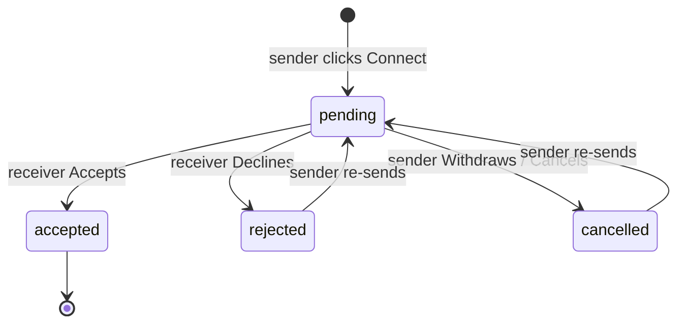

# Buddy Connections & Search

How users find each other, send buddy requests, and manage them. An **accepted** connection unlocks direct messages ([messaging.md](./messaging.md)) and study sessions ([study-sessions.md](./study-sessions.md)).

## Lifecycle

- Table `connection_requests` (`backend/app/models/connection_model.py`) has a unique constraint on `(sender_id, receiver_id)`. Re-sending after a cancel or reject **revives** the same row (`update_status` → `pending`); it doesn't insert a new one.
- `get_existing_interaction(a, b)` looks up the row in **either** direction. This is how A and B are prevented from sending each other two parallel requests.

## API — `/connections`

| Method | Path | Body | Purpose |
|---|---|---|---|
| POST | `/connections/send?sender_id=` | `{receiver_id, message?}` | Send a request (or revive a cancelled or rejected one). 400 if one is already pending or accepted. |
| POST | `/connections/accept?user_id=` | `{request_id}` | Receiver accepts. |
| POST | `/connections/reject?user_id=` | `{request_id}` | Receiver declines. |
| POST | `/connections/cancel?sender_id=` | `{request_id}` | Sender withdraws. |
| POST | `/connections/requested/{user_id}` | — | **Incoming** pending requests, with `sender_name`, `sender_avatar`, `sender_headline`, `sender_subjects` (up to 4). |
| GET | `/connections/my-buddies/sent/{user_id}` | — | Requests **you sent** that are pending or accepted, as `BuddyCard`s with `isRequestAccepted` and `connectionRequestId`. |
| GET | `/connections/my-buddies/connected/{user_id}` | — | Accepted buddies in either direction, as `BuddyCard`s. |

## Search — `GET /search/peers?q=&current_user_id=`

Matches username, profile name, headline, location, about, and `study_specs` (subjects). Returns `BuddyCard[]`. When `current_user_id` is passed, each card also carries the viewer's relationship to that person:

| `connectionStatus` | Meaning | Search card shows |
|---|---|---|
| `none` | No request, or the last one was cancelled or rejected | **Connect** |
| `sent` | Viewer sent a pending request | amber **Requested** badge + **Cancel request** |
| `received` | They sent the viewer a pending request | blue **Wants to connect** + **Decline** / **Accept** |
| `connected` | Accepted | green **Buddy** badge + **Message** (opens `/chat?peer=<id>`) |

Before this field existed, any old request row (including cancelled or rejected ones, and requests sent *to* you) showed as a disabled "Requested" button, which left people stuck. `connectionRequestId` is only non-zero for `sent`, `received` and `connected`.

## Frontend

| File | Role |
|---|---|
| `hooks/useConnections.ts` | `useConnectionActions` (send, accept, reject, cancel, with `busyId`) and `useBuddies` (connected, sent and incoming lists). |
| `hooks/useSearch.ts` | Debounced search and `setConnection(peerId, status, requestId)` for optimistic card updates. |
| `pages/Search.tsx` + `components/search/Result.tsx` | Picks the card state from `connectionStatus` (table above). Shows a "Buddies → Requested" link when you have pending sent requests. |
| `components/search/User.tsx` | Shared user card: `statusBadge`, a main action, and an optional secondary action (e.g. Decline). |
| `pages/Buddies.tsx` (`/my-buddies`, `?tab=connected|sent|incoming`) | **My Buddies** → Message. **Requested** → only *pending* sent requests, each with Withdraw. **Incoming** → sender details with Accept and Decline. |
| `pages/Home.tsx` | Incoming requests widget (up to 3) with Accept and Decline. |

## Where to manage requests

- **Withdraw a request you sent:** on the Search card ("Cancel request") or under Buddies → **Requested** → "Withdraw".
- **Decline a request you received:** on the Search card ("Decline"), Buddies → **Incoming**, or the Home page widget.
