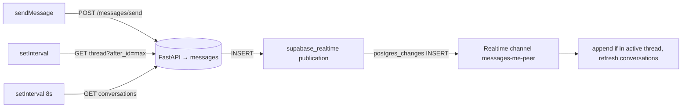

# Direct Messaging

One-to-one chat between **accepted study buddies**. Writes go through FastAPI; reads are polled,
and upgraded to push via Supabase Realtime when the frontend has Supabase credentials.

| Layer | File |
|---|---|
| Routes | `backend/app/routes/message_route.py` (prefix `/messages`) |
| Repository | `backend/app/repository/message_repo.py` (`MessageRepository`) |
| Model / schemas | `backend/app/models/message_model.py` (`Message`, `SendMessageSchema`, `MessageResponseSchema`, `ConversationPreviewSchema`) |
| Migration | `backend/migrations/versions/70cd8f5e4e31_create_messages_table.py` |
| Hook | `frontend/src/hooks/useMessages.ts` |
| Page | `frontend/src/pages/Chat.tsx` (route `/chat`) |
| Realtime client | `frontend/src/utils/supabaseClient.ts` |

## Data model

`messages(id PK, sender_id FK→user.id, receiver_id FK→user.id, content, is_read=false, created_at)`,
with composite indexes on `(sender_id, receiver_id)` and `(receiver_id, sender_id)`.

## Endpoints

All responses use the standard `ApiResponse` envelope (`data` holds the payload). None of these
routes check the JWT — the caller is whoever `sender_id` / `user_id` says (see
[ARCHITECTURE.md §5](ARCHITECTURE.md#5-authentication)).

| Method | Path | Params | Purpose |
|---|---|---|---|
| POST | `/messages/send` | query `sender_id`; body `{receiver_id, content}` | Send a message. 400 if messaging yourself or content is blank; 403 if not accepted buddies. Content is trimmed. Returns the created `MessageResponseSchema` (201). |
| GET | `/messages/thread/{user_id}/{peer_id}` | query `after_id` (default 0) | Messages between the two users with `id > after_id`, oldest first. `after_id` lets the client fetch only new messages. |
| POST | `/messages/thread/{user_id}/{peer_id}/read` | — | Mark every unread message **from `peer_id` to `user_id`** as read. Returns `{updated_count}`. |
| GET | `/messages/conversations/{user_id}` | — | One preview per accepted buddy: `{peer_id, name, avatar_url, last_message, last_message_time, unread_count}`, sorted by `last_message_time` desc (buddies with no messages last). |

`MessageResponseSchema`: `{id, sender_id, receiver_id, content, is_read, created_at}`.

### Only-accepted-buddies rule

`_assert_connected` calls `ConnectionRepository.get_existing_interaction(a, b)`, which returns the
first `connection_requests` row in **either** direction, and requires its status to be `accepted`;
otherwise `403 "You can only message accepted study buddies."`. The rule is enforced on
`/send` only — `GET /thread` returns history for any pair. Conversation previews are built from
`get_connected_peers_with_profiles`, so only accepted buddies appear in the sidebar; `name` is the
profile name, falling back to `user.username`. How requests become accepted is covered in
[connections-and-search.md](connections-and-search.md).

### Unread counts

- `unread_count` = messages where `sender_id = peer`, `receiver_id = me`, `is_read = false`.
- They are cleared when the user opens the thread: `selectConversation` calls
  `POST /thread/{me}/{peer}/read` and zeroes that conversation's badge locally.
- Read state also drives the double-tick on your own sent bubbles in `Chat.tsx` (second tick when `is_read`).
- Home and Chat show per-conversation badges; Home also sums them (see
  [home-dashboard.md](../frontend/docs/home-dashboard.md)).

## Live updates (`useMessages`)

`useMessages(userId)` returns `{conversations, activePeerId, messages, loadingConversations,
loadingThread, error, selectConversation, sendMessage, refreshConversations}`.

- **Conversation list**: fetched on mount and every 8 s.
- **Active thread**: `selectConversation(peerId)` resets state, loads the full thread
  (`after_id=0`), and marks it read. A poller then calls `GET /thread?after_id=<highest id seen>`
  every **3 s** without Supabase, or every **15 s** as a safety net when Realtime is on.
- **Realtime** (only if `VITE_SUPABASE_URL` and `VITE_SUPABASE_ANON_KEY` are set): subscribes to
  `postgres_changes` `INSERT` on `public.messages`. Rows belonging to the open thread are appended
  (deduplicated by `id`); any insert triggers `refreshConversations()`.
- **Sending**: `sendMessage(content)` posts, appends the message returned by the server,
  bumps the `after_id` cursor and refreshes the list. Errors surface as a toast in `Chat.tsx`.

No UI code changes are needed to switch modes — it is decided by `isSupabaseConfigured`.

### Supabase setup

The `70cd8f5e4e31` migration runs these best-effort (each in a savepoint, ignored on plain Postgres):
enable RLS on `messages`, create `SELECT USING (true)` and `INSERT WITH CHECK (true)` policies, grant
`SELECT, INSERT` to `anon`/`authenticated`, and `ALTER PUBLICATION supabase_realtime ADD TABLE messages`.
If the table was created by `create_all` instead of this migration, run those statements manually
(or Realtime will never fire and the hook silently stays on polling).

> **Privacy caveat.** Those policies let anyone holding the public anon key read **all** messages and
> insert arbitrary rows through Supabase's REST API, bypassing the buddies rule. The Realtime channel
> also receives every insert and filters client-side. Tightening this needs Supabase-auth-aware RLS
> (e.g. `auth.uid()` mapped to the app user) or a server-side broadcast instead.

## Chat page and `?peer=<id>` deep link

`Chat.tsx` has three panels: conversation list (with name search), active thread, and an optional
buddy-info sidebar (its "Schedule Study Session" / "Generate Shared Quiz" buttons and the
call/attach/emoji icons are not wired up yet).

Opening `/chat?peer=<userId>` selects that buddy's thread once conversations load. The param is
applied once per value (tracked in a ref) so clicking another chat isn't overridden; if the peer
isn't in the list (not an accepted buddy) or no param is given, the first conversation is opened.

Links that use it:

| From | Link |
|---|---|
| Home — DM strip and recent chats | `/chat?peer=${c.peer_id}` |
| Buddies — "Message" on a buddy card | `/chat?peer=${buddy.id}` |
| Session room — "Chat" button | `/chat?peer=${session.partner_id}` |

## Known limitations

- No auth on message routes (any client can read any thread or send as anyone).
- No pagination — `GET /thread` returns the full history on first load.
- `get_unread_count` loads rows to count them, and `/conversations` does 2 queries per buddy (N+1).
- `get_existing_interaction` takes the first matching row; if two rows exist (A→B and B→A) with
  different statuses, the result depends on row order.
