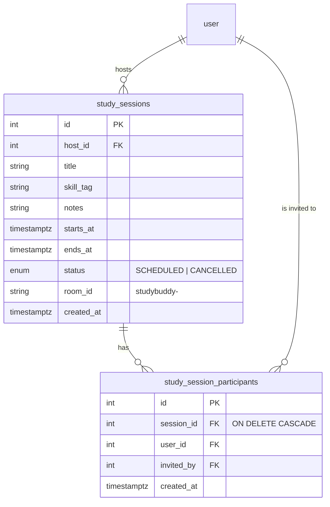

# Study Sessions (1:1 and group) + Video Rooms

Scheduled study slots between accepted buddies, with an in-app Jitsi video room. A session has one **host** and 1–7 **participants** (max 8 people total).

## Data model



- `(session_id, user_id)` is unique. The host is **not** stored in the participants table; they are identified by `study_sessions.host_id`.
- Migrations: `c3a91d7e5f20_create_study_sessions_table`, then `d4b2e8f1a903_add_study_session_participants`. The second one moves the old `buddy_id` column into the participants table and drops it.
- Files: `backend/app/models/study_session_model.py`, `backend/app/repository/study_session_repo.py`, `backend/app/routes/study_session_route.py`.

### Status is derived, not stored

Only `SCHEDULED` and `CANCELLED` are stored. The status the API returns comes from the clock:

| Condition | API `status` |
|---|---|
| stored `CANCELLED` | `cancelled` |
| now < `starts_at` | `upcoming` |
| `starts_at` ≤ now ≤ `ends_at` | `live` |
| now > `ends_at` | `completed` |

So a session dated in August can never show as "upcoming" in October. The frontend re-derives status every 30 s (`liveStatus` + `useNow` in `useSessions.ts`). Cards therefore move from upcoming to live to completed without a refetch.

All times are stored in UTC. The frontend converts local `<input type="date|time">` values with `fromDateTimeInputs()` in `utils/time.ts`.

## API — `/sessions`

All endpoints identify the caller with the `user_id` query param, following the other routers. Responses use the standard `ApiResponse` envelope.

| Method | Path | Who | Body | Purpose |
|---|---|---|---|---|
| POST | `/sessions/create?user_id=` | anyone | `{participant_ids[], title, skill_tag?, notes?, starts_at, ends_at}` | Create a session. Every invitee must be an **accepted buddy** of the host. Rejects past times and `ends_at <= starts_at`. |
| GET | `/sessions/user/{user_id}` | — | — | Sessions the user hosts **or** was invited to, ordered by `starts_at`. |
| GET | `/sessions/{id}?user_id=` | member | — | One session (404 if the caller is not a member). |
| POST | `/sessions/{id}/participants?user_id=` | any member | `{user_ids[]}` | Add people. Each person must be an accepted buddy of **the caller**. Session must not be cancelled or completed. Max 8 people. |
| POST | `/sessions/{id}/participants/{pid}/remove?user_id=` | host, or `pid == user_id` | — | The host removes someone, or a member leaves. Returns `data: null` when the caller left. The host can't leave; they cancel instead. |
| POST | `/sessions/{id}/reschedule?user_id=` | host | `{starts_at, ends_at}` | Change the time (also un-cancels). |
| POST | `/sessions/{id}/cancel?user_id=` | host | — | Cancel for everyone. |

### Response shape

```jsonc
{
  "id": 1,
  "host_id": 4,
  "is_host": true,               // viewer is the host
  "title": "Trees & DFS",
  "skill_tag": "DSA",
  "notes": "Agenda…",
  "starts_at": "2026-10-20T10:30:00Z",
  "ends_at": "2026-10-20T11:30:00Z",
  "status": "upcoming",          // derived, see table above
  "room_id": "studybuddy-Xy12…",
  "created_at": "…",
  "participants": [              // everyone except the viewer, host included
    { "id": 3, "name": "Asha", "avatar_url": "…", "is_host": false }
  ]
}
```

## Frontend

| File | Role |
|---|---|
| `hooks/useSessions.ts` | Fetch, create, reschedule, cancel, `addParticipants` and `removeParticipant` (leave). Also `liveStatus`, `useNow`, `participantLabel` ("Asha, Ravi +2") and `MAX_PARTICIPANTS`. |
| `pages/Sessions.tsx` (`/session`) | Stats, filters (all / live / upcoming / completed / cancelled), search, and cards with an avatar stack. Modals for **Book** (multi-select buddies), **Add people**, and **Reschedule**. |
| `components/sessions/Participants.tsx` | `AvatarStack` and `BuddyPicker` (toggle chips; already-in members are disabled). |
| `pages/SessionRoom.tsx` (`/session/:id/room`) | Pre-join screen, embedded Jitsi iframe, an "open in new tab" link, and a participant list where each name links to `/chat?peer=<id>`. |
| `pages/Home.tsx` | "Next session" card with countdown and Join button. |

Card actions depend on role and state:

| | upcoming | live | completed / cancelled |
|---|---|---|---|
| Host | Add people · Reschedule · Cancel · Open room | Add people · Join now | — |
| Invitee | Add people · Leave · Open room | Add people · Leave · Join now | — |

## Video rooms (Jitsi)

- Every session gets a random `room_id`. The room URL is `https://${VITE_JITSI_DOMAIN || "meet.jit.si"}/${room_id}`, with the display name and subject passed in the URL hash.
- Everyone in the session joins the same room, so group calls work out of the box. Jitsi's in-call chat serves as the group chat.
- **Caveat:** the public `meet.jit.si` server cuts calls in **embedded** iframes after about 5 minutes, and it asks the first person in the room to log in. The "New tab" button avoids the time limit. For production, set `VITE_JITSI_DOMAIN` to a self-hosted Jitsi server or JaaS (8x8). No code change is needed.

## Known limitations / next steps

- Invitees are added straight in; there's no accept/decline for session invites.
- No notifications or reminders yet; people find out from their Sessions page or Home.
- Like the other routers, the caller identity comes from `?user_id=` and is not checked against the JWT. See [ARCHITECTURE.md](./ARCHITECTURE.md).
